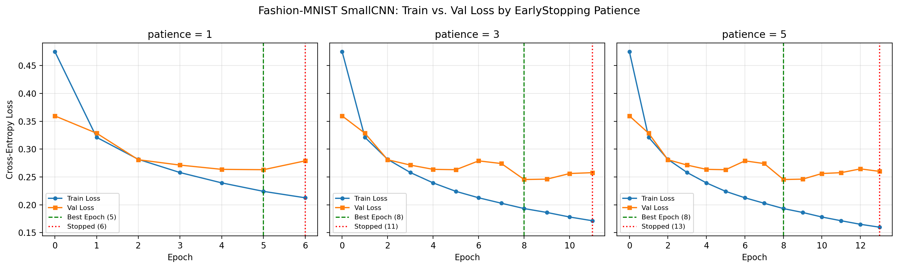
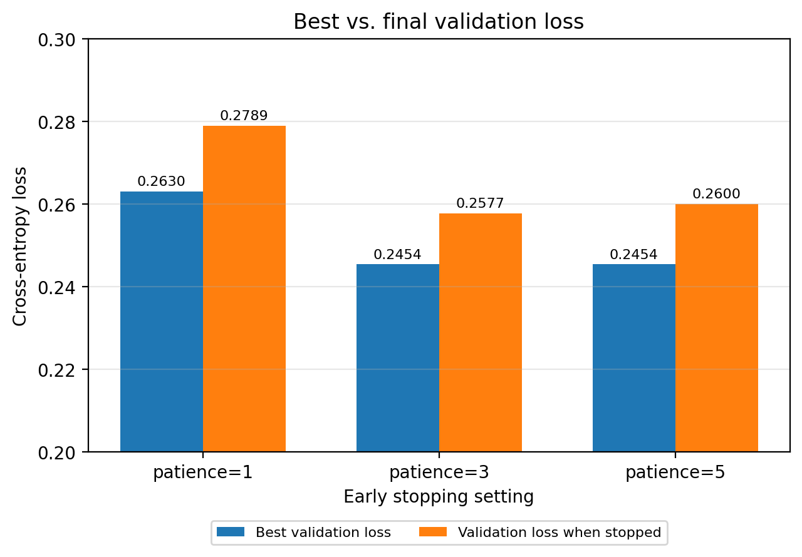

# When to Stop: Early Stopping and the Cost of One More Epoch
*By Kent Ormillada*

## The question

Every time you train a neural network, you make a quiet decision: when do you stop? Stop too early and the model hasn't learned enough. Stop too late and it starts memorising its training images instead of learning patterns that carry over to new ones.

So here is the question this post tries to answer:

**Once validation loss stops improving, how long should training wait before giving up, and what does one more epoch actually cost?**

I tested it on a small image classifier by changing a single setting, called *patience*, and measuring what happened. The full notebook is here: \[https://github.com/ormilladakent-beep/Blog-Post_DS413].

## What early stopping is, and what patience controls

Some quick vocabulary, since I'll use these words throughout:

- An **epoch** is one full pass through the training images.
- The **validation set** is a slice of data the model never trains on. It stands in for new, unseen images.
- **Validation loss** measures how wrong the model's predictions are on that slice. Lower is better.
- **Overfitting** is when training loss keeps falling while validation loss stalls or rises.

**Early stopping** watches validation loss after every epoch and ends training once it stops improving. **Patience** is how stubborn it is: the number of epochs in a row without a new best validation loss that it will tolerate before stopping.

The rule is simple. Keep track of the best (lowest) validation loss so far, plus a counter. After each epoch, if validation loss beat the best, update the best and reset the counter to zero. Otherwise, add one to the counter. When the counter reaches the patience value, stop.

Why does the number matter? Validation loss is noisy. With patience 1, a single bad epoch ends training, even if it was just a blip. With patience 5, the model gets five chances to recover, but you pay for each one in time, and each extra epoch can carry the model further from the best version it passed. Choosing patience is a bet on how noisy your validation curve is.

## Experiment setup

I compared patience = 1, 3 and 5 and kept everything else fixed.

| Setting | Value |
| --- | --- |
| Dataset | Fashion-MNIST, 55,000 training images (full training set, no subset) |
| Validation set | 5,000 images, split off with seed 42 |
| Model | Small CNN: two convolution layers (16 and 32 filters) and one linear layer, about 20,500 parameters |
| Optimizer | Adam, learning rate 1e-3 |
| Batch size | 64 |
| Maximum epochs | 20 (a ceiling, not a target) |
| Seed | 42 |
| Monitored metric | Validation loss |
| Hardware | CPU |

All comparisons use the validation set only. I never touched the test set. Each run also saved a checkpoint of its best-validation-loss weights using Lightning's `ModelCheckpoint`. Epochs are counted from 0, so a run that stops at epoch 6 has trained for 7 epochs.

The heart of the experiment is one function that I ran three times with a different `patience`:

```python
early_stop = EarlyStopping(monitor="val_loss", patience=patience, mode="min")
ckpt = ModelCheckpoint(monitor="val_loss", mode="min", save_top_k=1)
trainer = pl.Trainer(max_epochs=20, callbacks=[early_stop, ckpt])
```

## Results

*\*

**Figure 1.** Training and validation loss per epoch for each patience value. The green dashed line marks the epoch with the lowest validation loss; the red dotted line marks where training stopped.

Figure 1 shows that patience 1 stopped at epoch 6, before validation loss reached the lower point that patience 3 and 5 found at epoch 8.

| Patience | Epochs run | Best epoch | Best validation loss | Validation accuracy at best | Validation loss when stopped | Training time |
| --- | --- | --- | --- | --- | --- | --- |
| 1 | 7 | 5 | 0.2630 | 90.56% | 0.2789 | 425 s |
| 3 | 12 | 8 | 0.2454 | 90.62% | 0.2577 | 720 s |
| 5 | 14 | 8 | 0.2454 | 90.62% | 0.2600 | 829 s |

**Table 1.** Results for each patience value. All three runs share the same data, model, optimizer and seed.

Table 1 shows that patience 3 and 5 reached the same best validation loss (0.2454), while patience 1 stopped at 0.2630.

*\*

**Figure 2.** Best validation loss compared with validation loss at the moment each run stopped. The vertical axis is zoomed to 0.20 to 0.30 so the differences are visible.

Figure 2 shows that every run stopped on a validation loss higher than the best one it had seen.

## Discussion

**What happened.** Patience 1 hit its lowest validation loss at epoch 5 (0.2630). Then epoch 6 came in worse (0.2789), and training stopped.

But that dip at epoch 5 wasn't the real bottom. Patience 3 and 5 kept going and found 0.2454 at epoch 8. So stopping on a single bad epoch left patience 1 with a validation loss 0.0176 higher, about 7%.

Accuracy, on the other hand, barely noticed. Validation accuracy was 90.56% at patience 1 and 90.62% at patience 3 and 5. That 0.06-point gap is much smaller than the roughly 0.4 points of random wobble you'd expect from 5,000 validation images, so I wouldn't call it a real difference. Loss was the more sensitive signal here.

**What extra patience cost.** Patience 5 found nothing that patience 3 had missed. It ran two more epochs and took about 109 seconds longer (829 s versus 720 s).

It also ended on a slightly worse model: validation loss 0.2600 versus 0.2577, while training loss kept falling (0.1714 to 0.1598). That's the first hint of overfitting. The model keeps getting better on images it has seen and no better on images it hasn't.

Patience 3 and 5 tying exactly isn't luck. Every run uses the same seed, so they follow the same training path until one of them stops. That makes the comparison clean. It also means I'm looking at one trajectory, not three independent ones.

**Did it match the theory?** Partly. Theory says patience is a trade: more of it should give an equal or better best model, at a higher cost in time. That held. Patience 1 was cheapest and worst, and patience 3 and 5 tied on quality.

**What surprised me** was how gentle the overfitting was. Validation loss rose only 0.0146 above its best over five extra epochs. My guess is that a tiny model (about 20,500 parameters) trained on 55,000 images can't memorise the training set very fast. A bigger model or a smaller training set would probably punish extra patience harder, but I haven't tested that.

**Limitations.** Three things to keep in mind:

- I used a single seed. A different seed could change the noise in the validation curve, the best epoch, and which setting wins.
- I didn't run a baseline without early stopping, so I can't say what all 20 epochs would have done. If validation loss dipped lower later, even patience 5 was too impatient.
- Training times are wall-clock seconds on a CPU, so they include overhead and would differ on other hardware.

## Takeaways

1. **Patience 1 is too twitchy for a noisy validation curve.** It saved about five epochs compared with patience 3, but cost 0.0176 in validation loss.
2. **A moderate patience was enough.** Patience 3 found the best epoch. Patience 5 only added two epochs and about two minutes.
3. **Save the best checkpoint and reload it.** Every run stopped on weights worse than its best (by 0.0123 to 0.0159 in validation loss), so don't just keep whatever training ended on.

## References

- PyTorch Lightning documentation, `EarlyStopping` callback: https://lightning.ai/docs/pytorch/stable/common/early\_stopping.html
- Prechelt, L. (1998). Early Stopping - But When? In *Neural Networks: Tricks of the Trade*. Springer.
- Goodfellow, I., Bengio, Y., and Courville, A. (2016). *Deep Learning*, Section 7.8 (Early Stopping). MIT Press. https://www.deeplearningbook.org/
- Xiao, H., Rasul, K., and Vollgraf, R. (2017). Fashion-MNIST: a Novel Image Dataset for Benchmarking Machine Learning Algorithms. arXiv:1708.07747.
- Class notebook `hyperparameters_lightning.ipynb`
